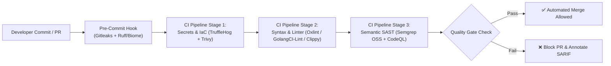

# Awesome Static Analysis & Code Quality Verification 🛡️⚡

  

  
  
  
  
  

---

## 🧭 Executive Summary & SEO Guide

**Awesome Static Analysis & Code Quality Verification** is a comprehensive, curated index of industrial **SaaS platforms**, **developer-first static application security testing (SAST)** engines, **ultra-fast Rust linters**, **type checkers**, **secret scanners**, and **CI/CD quality gates**.

Static code analysis inspects source code and abstract syntax trees (AST) without program execution to prevent zero-day vulnerabilities, detect hardcoded secrets (API keys/tokens), enforce idiomatic type safety, eliminate dead code, and monitor technical debt. Modern DevSecOps teams leverage these automated checks to achieve **Shift-Left Security**, SOC 2 compliance, and continuous pull-request verification across multi-language enterprise microservices.

---

## 📑 Table of Contents

- [📊 Sector Overview & Market Dynamics](#-sector-overview--market-dynamics)
- [☁️ Top SaaS & Cloud Code Quality Platforms](#️-top-saas--cloud-code-quality-platforms)
- [💻 Leading Open-Source Tools & Engines](#-leading-open-source-tools--engines)
- [🏗️ Recommended Architecture: Self-Hosted CI Quality Gate](#️-recommended-architecture-self-hosted-ci-quality-gate)
- [🤝 How to Contribute](#-how-to-contribute)
- [⚖️ Disclaimer & License](#️-disclaimer--license)

---

## 📊 Sector Overview & Market Dynamics

> 💡 **Market Valuation & Growth**: The global static code analysis and Static Application Security Testing (SAST) market is estimated at **$1.5B to $2.2B** (projected to reach **$4.5B+ to $6.0B+** by 2032–2034) expanding at a robust **16.5% to 22.8% CAGR**, catalyzed by the explosion of AI-generated code, stringent software supply chain cybersecurity directives (NIST SP 800-218, EU Cyber Resilience Act), and automated CI/CD shift-left adoption.

> 🧩 **Competitive Concentration vs. Ecosystem Fragmentation**: The sector demonstrates a **moderately concentrated core at the enterprise level**—where a handful of deep-pocketed legacy incumbents and unicorn vendors (Snyk, SonarSource, Veracode, Synopsys/Black Duck, Checkmarx) capture dominant enterprise AppSec budgets—surrounded by a **highly fragmented, dynamic developer ecosystem** of language-specific linters, next-generation Rust/Go-based AST engines (Biome, Ruff, Oxlint), and specialized open-source security scanners.

---

## ☁️ Top SaaS & Cloud Code Quality Platforms

*The following table lists top commercial hosted code analysis platforms, sorted descending by enterprise scale (company valuation and annual revenue run rate).*

| Platform 🚀 | Company Scale & Valuation 📈 | Starting Tier Pricing 🏷️ | Free Tier / Trial Limits 🎁 | Core Focus & Verification Highlights 🔍 |
| :--- | :--- | :--- | :--- | :--- |
| **[Snyk Code](https://snyk.io)** | **$7.4B** valuation (Series G) / ~$300M+ ARR | **$25 / month** (Team plan starting tier up to 10 devs & 1,000 SAST scans/mo) | **Free forever** with 100 SAST tests/month, up to 5 projects, IDE/CLI access, and DeepCode AI real-time vulnerability scanning. | Developer-first AI-powered SAST platform providing real-time vulnerability scanning, automated 1-click fix pull requests, and IDE integrations. |
| **[SonarQube Cloud](https://sonarsource.com)** | **$4.7B** valuation (Series D) / ~$200M+ ARR | **$34 / month** (Team plan starting tier for up to 100,000 lines of code) | **Free forever** for up to 50,000 lines of code (LOC) on private repositories; **unlimited LOC** for public open-source repositories. | Cloud-based continuous code quality inspection service offering automated PR decoration, branch analysis, Clean Code standards, and multi-language quality gates. |
| **[Veracode Static Analysis](https://veracode.com)** | **$2.5B** acquisition valuation (TA Associates / Thoma Bravo) | **$12,000 / year** (Starting entry module contract; ~$800–$1,500/seat/year) | **No perpetual free plan**; 14-day free trial available for select modules (e.g. Security Labs) and custom sales-led PoC evaluation. | Enterprise cloud SAST platform scanning compiled binaries and source code for OWASP Top 10 and CWE vulnerabilities with strict compliance reporting. |
| **[Black Duck Coverity](https://blackduck.com)** | **$2.1B** acquisition valuation (Clearlake Capital / Francisco Partners) | **$50,000 / year** (Starting commercial deployment bundle; ~$800–$1,500/seat/year) | **Coverity Scan free forever** for public open-source software projects; custom sales-led commercial PoC evaluation. | Industrial-grade static analysis engine for C, C++, C#, Java, and web languages targeting deep concurrency, memory corruption, and security defects. |
| **[Checkmarx One](https://checkmarx.com)** | **$1.15B** acquisition valuation (Hellman & Friedman) | **$30,000 / year** (Starting enterprise contract bundle; ~$800–$2,000/seat/year) | **No perpetual free plan**; 30-day free trial for Checkmarx Developer Assist and custom sales-led PoC evaluation. | Enterprise cloud application security platform combining SAST, Infrastructure-as-Code (IaC) scanning, API security, and supply-chain verification. |
| **[Code Climate (Qlty Cloud)](https://qlty.sh)** | **~$100M** valuation / ~$66M total funding | **$20 / seat / month** (Pro plan starting tier; billed annually or monthly) | **Free forever** for 1,000 analysis minutes/month and 100 AI autofixes; 14-day free trial on enterprise solutions. | Maintainability, technical debt, and test coverage analytics platform providing automated pull-request quality checks and multi-linter orchestration. |
| **[Codacy](https://codacy.com)** | **~$75M** valuation / ~$23M total funding | **$18 / developer / month** (Team plan billed annually; or $21 monthly) | **Free forever Developer plan** for individual developers (IDE/CLI/local analysis); **free forever** for all public open-source repositories. | Cloud code quality and AppSec platform aggregating static analysis, complexity metrics, duplication tracking, and coverage enforcement across 40+ languages. |
| **[DeepSource](https://deepsource.com)** | **~$50M** valuation / ~$7.8M funding (YC, SoftBank) | **$24 / developer / month** (Team plan billed annually; or $30 monthly) | **Free forever** for small teams up to 3 members and 3 private repositories; **unlimited** for public open-source repositories. | Automated static analysis and code health platform detecting bug risks, anti-patterns, security flaws, and coverage gaps with Autofix PRs. |

---

## 💻 Leading Open-Source Tools & Engines

*The following table features top-tier open-source static analyzers, SAST checkers, type checkers, and linters, sorted descending by GitHub community star count.*

| Tool / Engine 🛠️ | GitHub Popularity ⭐ | Description & Verification Capabilities 📝 |
| :--- | :--- | :--- |
| **[Ruff](https://github.com/astral-sh/ruff)** |  | Extremely fast Python linter and code formatter written in Rust, replacing Flake8, isort, pyupgrade, and Bandit rulesets with 10–100x performance gains. |
| **[ShellCheck](https://github.com/koalaman/shellcheck)** |  | Essential static analysis and linting tool for `sh`/`bash` shell scripts catching syntax pitfalls, quoting bugs, and portability issues. |
| **[Trivy](https://github.com/aquasecurity/trivy)** |  | Comprehensive open-source security scanner for Infrastructure-as-Code (Terraform, Kubernetes, Dockerfiles), container images, and software dependencies. |
| **[Gitleaks](https://github.com/gitleaks/gitleaks)** |  | Fast, lightweight SAST scanner for detecting and preventing hardcoded secrets, API tokens, and credentials in Git repositories and CI pipelines. |
| **[TruffleHog](https://github.com/trufflesecurity/trufflehog)** |  | High-depth secret scanner searching Git history, filesystems, and S3 buckets with real-time API verification against active provider endpoints. |
| **[ESLint](https://github.com/eslint/eslint)** |  | Pluggable, industry-standard JavaScript and TypeScript static code analysis engine with an extensive ecosystem of security, framework, and stylistic plugins. |
| **[Biome](https://github.com/biomejs/biome)** |  | Ultra-fast Rust-based web development toolchain providing formatting, linting, and diagnostics for JavaScript, TypeScript, JSX, and JSON. |
| **[Oxlint (Oxc)](https://github.com/oxc-project/oxc)** |  | High-performance JavaScript/TypeScript linter written in Rust, built for extreme CI throughput and developer speed with zero-configuration defaults. |
| **[GolangCI-Lint](https://github.com/golangci/golangci-lint)** |  | Fast, parallel Go linters runner aggregating dozens of static analysis linters (including `govet`, `staticcheck`, and `gosec`) into a unified CI pipeline. |
| **[Semgrep OSS](https://github.com/semgrep/semgrep)** |  | Fast, lightweight static analysis engine for finding bugs and enforcing custom security standards across 30+ languages using syntax-aware pattern matching. |
| **[Sure](https://github.com/we-promise/sure)** |  | Modern open-source personal finance application featuring exemplary automated CI verification, RuboCop/Brakeman SAST, and comprehensive test suites. |
| **[Meta Infer](https://github.com/facebook/infer)** |  | Industrial-grade static analyzer for Java, C, C++, and Objective-C detecting memory leaks, null pointer dereferences, and concurrency data races. |
| **[PHPStan](https://github.com/phpstan/phpstan)** |  | Static analysis engine for PHP that detects whole classes of runtime bugs, type violations, and incorrect method signatures without running tests. |
| **[Clippy](https://github.com/rust-lang/rust-clippy)** |  | Official Rust compiler linter collection offering over 700 checks to catch common developer mistakes, performance bottlenecks, and non-idiomatic code. |
| **[RuboCop](https://github.com/rubocop/rubocop)** |  | The premier community-driven Ruby static code analyzer (linter) and formatter enforcing compliance with the official Ruby Style Guide. |
| **[Hadolint](https://github.com/hadolint/hadolint)** |  | Smarter Dockerfile linter that parses Dockerfiles into an AST and evaluates inline `RUN` shell instructions against ShellCheck rules. |
| **[SonarQube Community Build](https://github.com/SonarSource/sonarqube)** |  | Self-hosted open-source platform for continuous code quality inspection, technical debt tracking, and quality gate enforcement across 30+ languages. |
| **[GitHub CodeQL](https://github.com/github/codeql)** |  | Advanced semantic code analysis engine and open-source query packs treating source code as data to detect zero-days and taint-tracking vulnerabilities. |
| **[Checkstyle](https://github.com/checkstyle/checkstyle)** |  | Highly configurable static code analysis tool for Java verifying compliance with coding standards like Sun Code Conventions and Google Java Style. |
| **[Gosec](https://github.com/securego/gosec)** |  | Dedicated Go AST-based security checker inspecting Go source code for common vulnerabilities, SQL injection, and weak cryptography implementations. |
| **[Bandit](https://github.com/PyCQA/bandit)** |  | Security-oriented static analysis tool for Python AST inspection designed to detect common security flaws like hardcoded passwords and shell injection. |
| **[Brakeman](https://github.com/presidentbeef/brakeman)** |  | Zero-configuration vulnerability static scanner tailored specifically for Ruby on Rails applications, catching SQLi, XSS, and mass assignment flaws. |
| **[Error Prone](https://github.com/google/error-prone)** |  | Static analysis tool for Java developed by Google that hooks into the compiler to catch common programming mistakes and anti-patterns at compile-time. |
| **[Pyre Check](https://github.com/facebook/pyre-check)** |  | Performant, strictly compliant type checker and static analysis engine for Python codebases developed and maintained by Meta. |
| **[Detekt](https://github.com/detekt/detekt)** |  | Static code analysis, anti-pattern detector, and code smell identification engine tailored specifically for Kotlin applications. |
| **[Cppcheck](https://github.com/danmar/cppcheck)** |  | Static analysis tool for C/C++ code focusing on undefined behaviors, memory leaks, buffer overflows, and null pointer dereferences. |
| **[Psalm](https://github.com/vimeo/psalm)** |  | Static analysis tool for finding type errors and potential vulnerabilities in PHP applications, featuring strict type inference and taint tracking. |
| **[PMD](https://github.com/pmd/pmd)** |  | Extensible cross-language static code analyzer supporting Java, JavaScript, Apex, and PL/SQL to detect dead code and suboptimal constructs. |
| **[SpotBugs](https://github.com/spotbugs/spotbugs)** |  | The spiritual successor to FindBugs; inspects compiled Java bytecode against 400+ bug patterns to catch concurrency, correctness, and security flaws. |
| **[MegaLinter](https://github.com/oxsecurity/megalinter)** |  | 100% open-source multi-linter tool aggregating 50+ linters to inspect every language, IaC, and configuration file consistently in CI pipelines. |

---

## 🏗️ Recommended Architecture: Self-Hosted CI Quality Gate

To achieve defense-in-depth verification without vendor lock-in, configure your automated CI/CD pipeline (e.g. GitHub Actions, GitLab CI) with layered open-source analyzers:

---

## 🤝 How to Contribute

Contributions are warmly welcomed! Help us keep this static analysis guide accurate, fresh, and comprehensive:

1. 🍴 **Fork the repository** on GitHub.
2. 🌿 **Create a new branch**: `git checkout -b feature/add-new-analyzer`
3. ✍️ **Add or refine an entry** in `README.md` following the table formatting:
   - For SaaS tools: include verified starting tier pricing, free forever limits or free trial terms, and company scale.
   - For open-source tools: provide the exact GitHub repository link and ensure proper star count badge formatting.
4. 🚀 **Commit your changes**: `git commit -m "feat: add new static analyzer entry"`
5. 📬 **Submit a Pull Request** with a concise description of the tool and why it adds value.

---

## ⚖️ Disclaimer & License

- **Community Maintained**: This repository is a community-driven educational and engineering resource — not an endorsement of any commercial platform.
- **Defense in Depth**: Static analysis is not a panacea. Always pair SAST with Dynamic Application Security Testing (DAST), software composition analysis (SCA), and manual architecture code reviews.
- **License**: Released under the [Creative Commons Zero v1.0 Universal](LICENSE) (Public Domain Dedication). Feel free to share and adapt!

---

  <b>Built with ❤️ for software engineers, AppSec professionals, and open-source creators worldwide.</b> 
  <i>Empowering developers to write safer, cleaner, and faster code.</i>

